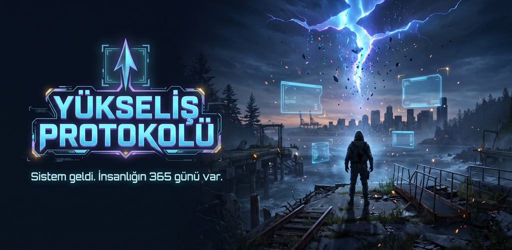

# Yükseliş Protokolü · Ascension Protocol



Android için tek oyunculu, tamamen metin tabanlı bir LitRPG. Türkçe ve İngilizce (Kuzey Amerika yerelleştirmesi).

> Gökyüzünde mavi bir pencere açıldı. Sistem geldi ve insanlığa 365 gün verdi.
> Herkes standart Sistem'i aldı. Sen bozuk olanını.

*A single-player, fully text-based LitRPG for Android, in Turkish and English. Offline, no ads, no in-app purchases.*

**Durum:** sürüm 1.0.0. Oyun baştan sona oynanabilir; Google Play öncesi son kontroller sürüyor
(güncel durum: [`docs/PROGRESS.md`](docs/PROGRESS.md)).

## Oyun

- **365 gün, 17 bölüm ve final.** Her bölüm brifing, hazırlık, ana operasyon ve sonrası ritmiyle ilerler; kararların haftalar sonra geri döner.
- **9 son.** Hangi sona vardığını seçtiklerin, kurduğun ilişkiler ve neye dönüştüğün belirler.
- **Davranıştan doğan sınıf.** Sınıf menüden seçilmez; Sistem nasıl oynadığına bakıp teklif eder. 8 temel sınıf, gizli sınıflar, evrimler.
- **Yoldaşlar ve fraksiyonlar.** Güven, saygı, korku ve bağlılık eksenleri; hatırlayan, ayrılan, ihanet eden NPC'ler.
- **Sıra tabanlı savaş, 100 katlı Kule, kapılar.**
- **Tamamen çevrimdışı.** İnternet izni, reklam, uygulama içi satın alma ve veri toplama yok. Tüm metin önceden yazılmıştır; yapay zeka anlatıcı yoktur.
- **Demir Mod** (kalıcı ölüm) ve **Yeni Oyun+**.

İçerik: 526 olay, yaklaşık 27.500 metin çifti (her biri TR + EN).

## Derlemek ve çalıştırmak

1. [Android Studio](https://developer.android.com/studio)'yu kur (Android SDK, JDK ve emülatör onunla gelir).
2. Android Studio → **Open** → bu klasörü seç. İlk açılışta Gradle bağımlılıkları indirilir.
3. Bir emülatör seç ya da telefonunu USB hata ayıklama ile bağla, ▶ **Run**'a bas.

Komut satırından (Windows'ta Git Bash; `JAVA_HOME` Android Studio'nun JBR klasörünü göstermeli):

```bash
./gradlew :engine:test             # motor testleri
./gradlew :engine:validateContent  # içerik doğrulaması
./gradlew assembleDebug            # APK → app/build/outputs/apk/debug/
./gradlew installDebug             # bağlı telefona ya da emülatöre kur
./gradlew bundleRelease            # AAB (keystore.properties yoksa imzasız)
scripts/check.sh                   # test + doğrulama + denge testi + derleme + lint
```

Sürümler: Gradle 9.1, AGP 8.13.2, Kotlin 2.2.21; minSdk 26, targetSdk 36.
İmzalama anahtarı ve `keystore.properties` depoya girmez.

## Klasörler

| Klasör | İçerik |
| --- | --- |
| `engine/` | Saf Kotlin oyun motoru: tüm oyun kuralları, kayıt, i18n, içerik doğrulayıcı. Android'e bağımlı değildir. |
| `app/` | Jetpack Compose arayüzü; yalnızca gösterir. |
| `content/` | Oyun içeriği (YAML): olaylar, NPC'ler, düşmanlar, sınıflar, sonlar. Her metin `{ tr, en }`. |
| `tools/` | Denge simülatörü, içerik taraması, Türkçe üslup ölçümü, arayüz inceleme betikleri. |
| `docs/` | Tasarım ve süreç belgeleri. |
| `fastlane/metadata/` | Google Play mağaza metinleri ve görselleri (TR, EN). |
| `scripts/` | `check.sh`: her aşamanın sonunda geçmesi gereken kontroller. |

## Belgeler

- [`docs/GDD.md`](docs/GDD.md) · [`docs/GDD.en.md`](docs/GDD.en.md): oyun tasarım dokümanı (TR ana kaynak; EN yerelleştirme ve isimler)
- [`docs/DECISIONS.md`](docs/DECISIONS.md): tasarım ve uygulama kararları, gerekçeleriyle
- [`docs/PROGRESS.md`](docs/PROGRESS.md): güncel durum ve açık işler
- [`docs/CHAPTERS.md`](docs/CHAPTERS.md) · [`docs/STORY_FLOW.md`](docs/STORY_FLOW.md): bölüm yapısı ve hikaye akışı
- [`docs/BALANCE.md`](docs/BALANCE.md): 1000 oynanışlık denge raporu (son dağılımı, seviye eğrisi)
- [`docs/QA.md`](docs/QA.md) · [`docs/UI_REVIEW.md`](docs/UI_REVIEW.md): kalite ve arayüz incelemeleri
- [`docs/PRIVACY.md`](docs/PRIVACY.md): gizlilik politikası taslağı
- [`CLAUDE.md`](CLAUDE.md): Claude Code ile geliştirirken geçerli proje kuralları ve mimari

## Mimari kısaca

- `WorldState` tek doğruluk kaynağıdır ve değişmezdir; yalnızca etkiler ve oyuncu eylemleriyle yeni bir durum üretilir.
- Tüm rastgelelik tohumlu tek bir üreteçten gelir: aynı tohum, aynı oynanış.
- Kayıtlar sürümlü JSON'dur; eski kayıtlar yeni sürümde açılır.
- İçerik koddan ayrıdır: yeni olay yazmak için Kotlin'e dokunmak gerekmez, `content/` altına YAML eklenir ve doğrulayıcıdan geçirilir.

## Lisanslar

Yazı tipleri (Literata, JetBrains Mono, Chakra Petch) SIL Open Font License 1.1 ile dağıtılır; metinleri
`app/src/main/assets/licenses/` altındadır. Kullanılan kütüphaneler (AndroidX, Jetpack Compose, kotlinx, kaml) Apache 2.0 lisanslıdır.
